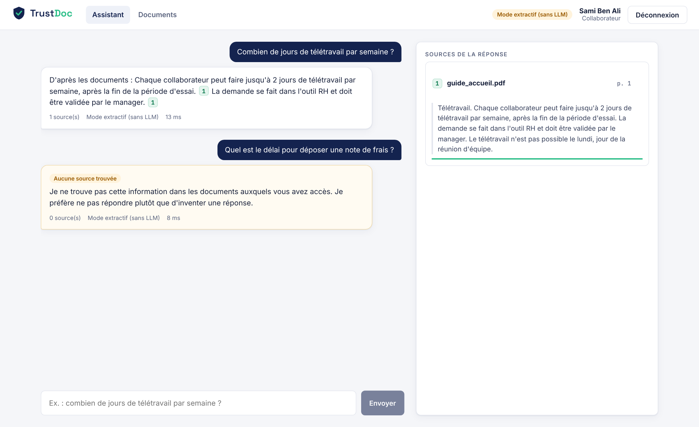
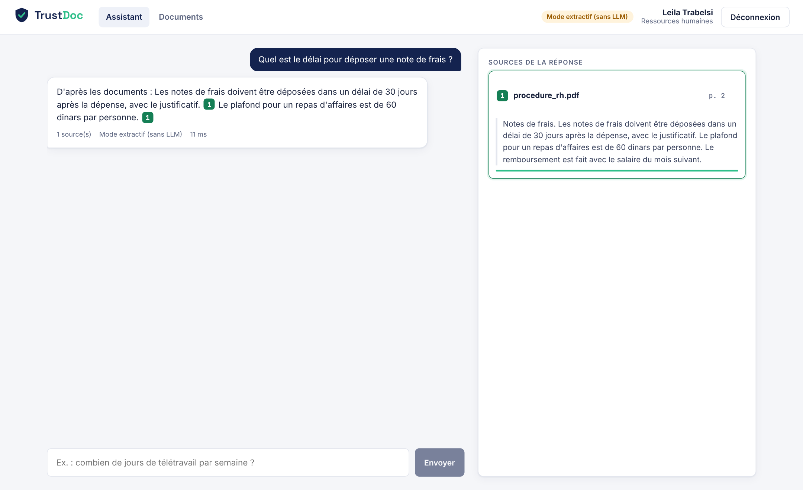
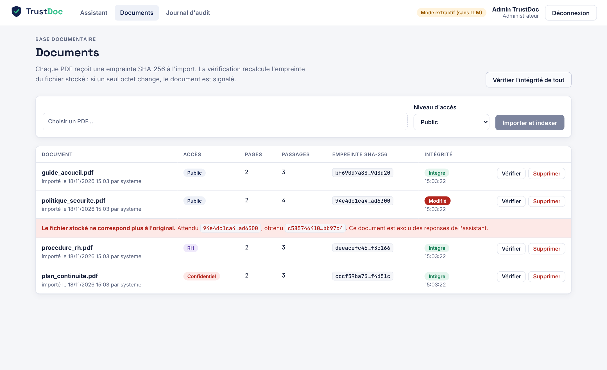
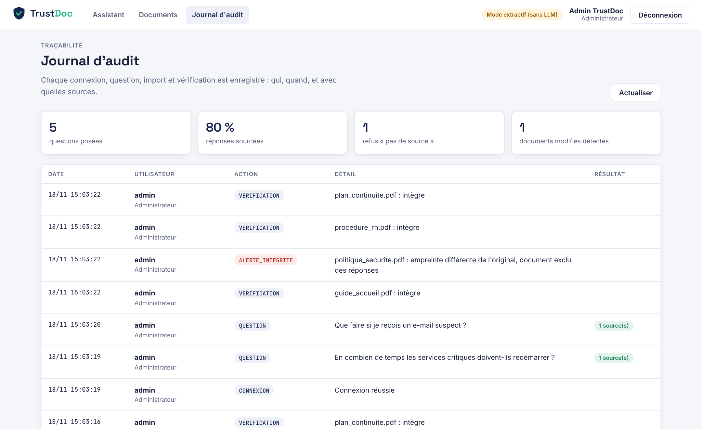
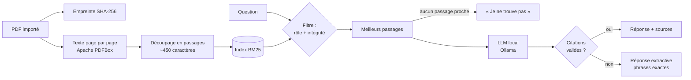

# TrustDoc

    

**Une base de connaissances IA « de confiance » pour l'entreprise : l'assistant répond aux questions
des collaborateurs à partir des documents internes, en citant la page exacte, et seulement à partir
des documents que chaque personne a le droit de lire.**



## Pourquoi « de confiance » ?

Un chatbot classique peut inventer une réponse, mélanger des documents confidentiels ou envoyer les
données de l'entreprise sur internet. TrustDoc est construit autour de quatre garanties :

| Garantie | Comment |
|---|---|
| **Réponses sourcées** | Chaque information est suivie de sa source `[1]` : document + page + passage exact. Si la réponse du modèle ne cite aucune vraie source, elle est rejetée. Si aucun passage n'est assez proche de la question, l'assistant répond « je ne trouve pas » au lieu d'inventer. |
| **Documents intègres** | À l'import, chaque PDF reçoit une **empreinte SHA-256**. La vérification (manuelle ou toutes les 10 minutes) recalcule l'empreinte : si un seul octet a changé, le document est marqué **Modifié**, une alerte est écrite dans le journal et le document est **exclu des réponses**. |
| **Accès par rôle** | Collaborateur → documents publics ; RH → public + RH ; Administrateur → tout. Le filtre est appliqué **avant** la recherche : un passage interdit n'est jamais envoyé au modèle. |
| **IA souveraine** | Par défaut, le modèle tourne **en local avec Ollama** : les documents ne quittent pas le serveur. Une API externe (OpenAI, Groq, Mistral…) reste possible en option. |

Tout est **tracé** dans un journal d'audit : connexions, questions, imports, vérifications et alertes.

## Captures

| Collaborateur : réponse sourcée, puis refus pour une information RH | La RH pose la même question : réponse sourcée |
|---|---|
|  |  |

**Un fichier a été modifié sur le disque : TrustDoc le détecte et l'exclut des réponses.**



**Journal d'audit (administrateur).**



> Les captures sont prises en **mode extractif** (sans LLM) : l'assistant reprend mot pour mot les phrases
> des documents. Avec Ollama, la réponse est rédigée par le modèle, toujours avec ses citations vérifiées.

## Comment ça marche (RAG)



1. **Import** : extraction du texte page par page, découpage en passages sans couper les phrases, empreinte SHA-256.
2. **Recherche** : moteur **BM25** (la formule de Lucene et Elasticsearch), avec un analyseur français (accents, mots vides, pluriels).
3. **Seuil de confiance** : on ne répond que si le meilleur passage contient au moins la moitié des mots-clés de la question.
4. **Génération** : le modèle reçoit uniquement les passages autorisés, numérotés, et doit citer `[n]` après chaque information.
5. **Contrôle** : les numéros inventés sont retirés ; une réponse sans citation valide est remplacée par une réponse extractive.

## Évaluation

Un jeu de **16 questions** avec la réponse attendue (document, page, fait) et **3 questions hors sujet** est
rejoué à chaque `mvn test` ([`RetrievalEvalTest`](backend/src/test/java/com/trustdoc/RetrievalEvalTest.java)) :

| Mesure | Résultat |
|---|---|
| Bon document en 1re source | **16 / 16** |
| Bonne page | **16 / 16** |
| Fait attendu présent dans la réponse | **16 / 16** |
| Questions hors sujet refusées | **3 / 3** |

> Mesuré en mode extractif sur les 4 documents de démonstration. C'est un petit jeu de test : il sert à éviter
> les régressions, pas à prouver la qualité sur de vrais documents d'entreprise.

**32 tests JUnit** au total : découpage, recherche, citations, droits par rôle, refus, intégrité (un bit modifié
→ alerte), chemin LLM (réponse valide, réponse sans citation, modèle qui ne sait pas, modèle en panne, format de l'appel Ollama).

## Lancer le projet

Il faut seulement **Java 17 ou plus**. Maven est téléchargé automatiquement par `mvnw`, et l'interface Angular est déjà compilée dans le backend.

**Windows**
```bat
cd backend
mvnw.cmd spring-boot:run
```
**Linux / macOS**
```bash
cd backend
./mvnw spring-boot:run
```
Ouvrir **http://localhost:8080**. Quatre documents fictifs (entreprise « Orbis Services ») sont importés au premier démarrage.

| Compte | Mot de passe | Accès |
|---|---|---|
| `employe` | `employe123` | Documents publics |
| `rh` | `rh123` | Public + RH, import |
| `admin` | `admin123` | Tout, suppression, journal d'audit |

### Avec l'IA locale (Ollama)

1. Installer Ollama : https://ollama.com/download
2. Télécharger un petit modèle (environ 2 Go) : `ollama pull llama3.2:3b`
3. Lancer TrustDoc normalement : le mode `ollama` est celui par défaut. Le badge en haut indique « IA locale (Ollama) ».

Si Ollama n'est pas lancé, TrustDoc continue de répondre en **mode extractif**.

### Autres modes

```bat
:: Sans LLM
set TRUSTDOC_LLM_MODE=extractif
:: API compatible OpenAI (OpenAI, Groq, Mistral...)
set TRUSTDOC_LLM_MODE=openai
set OPENAI_API_KEY=...
set OPENAI_BASE_URL=https://api.groq.com/openai/v1
set OPENAI_MODEL=llama-3.1-8b-instant
```

### Docker (TrustDoc + Ollama)

```bash
docker compose up -d
docker compose exec ollama ollama pull llama3.2:3b
```

### Développer l'interface

```bash
cd frontend
npm install
npx ng serve        # http://localhost:4200, les appels /api vont vers le backend (port 8080)
npx ng build        # recompile l'interface dans backend/src/main/resources/static
```

## API

| Méthode | Route | Rôle | Description |
|---|---|---|---|
| POST | `/api/auth/login` | tous | Connexion, renvoie un jeton JWT |
| POST | `/api/chat` | connecté | `{"question": "..."}` → réponse, sources, mode |
| GET | `/api/documents` | connecté | Documents visibles pour son rôle |
| POST | `/api/documents` | ADMIN, RH | Import d'un PDF (`file`, `accessLevel`) |
| POST | `/api/documents/{id}/verify` | connecté | Vérifie l'empreinte SHA-256 d'un document |
| POST | `/api/documents/verify` | connecté | Vérifie tous ses documents |
| DELETE | `/api/documents/{id}` | ADMIN | Suppression |
| GET | `/api/audit` | ADMIN | Journal d'audit |
| GET | `/api/status` | connecté | Mode IA, modèle, nombre de documents et de passages |

## Structure

```
backend/   Spring Boot 3 : sécurité JWT, PDFBox, BM25, LLM, audit, tests JUnit
  src/main/java/com/trustdoc/
    auth/    connexion, jetons JWT, utilisateurs de démonstration
    docs/    import, découpage, SHA-256, vérification planifiée
    search/  analyseur français + index BM25 avec filtre d'accès
    llm/     Ollama, API compatible OpenAI
    chat/    RAG : seuil de confiance, prompt, contrôle des citations, mode extractif
    audit/   journal d'audit
frontend/  Angular 18 : connexion, assistant avec sources, documents, journal d'audit
samples/   les 4 PDF de démonstration et le script qui les génère
```

## Limites (honnêtes)

- La recherche est **lexicale** (BM25) : elle trouve les mots de la question, pas encore les synonymes. Étape suivante : une recherche hybride avec des embeddings (PostgreSQL + pgvector).
- Les PDF scannés (images) ne sont pas lus : il faudrait un OCR.
- Les comptes sont des comptes de démonstration ; en entreprise, on brancherait l'annuaire (LDAP, SSO).
- L'empreinte SHA-256 détecte une modification du fichier stocké ; elle ne prouve pas qui a créé le document. Pour cela, il faudrait une **signature électronique** du document à l'import.
- Les documents de démonstration et l'entreprise « Orbis Services » sont fictifs.

## Auteur

**Rached ILAHI** — élève ingénieur en génie informatique, ENICarthage

[LinkedIn](https://www.linkedin.com/in/rached-ilahi-5b5101366/) · [Portfolio](https://rached12364.github.io/) · [GitHub](https://github.com/Rached12364)
